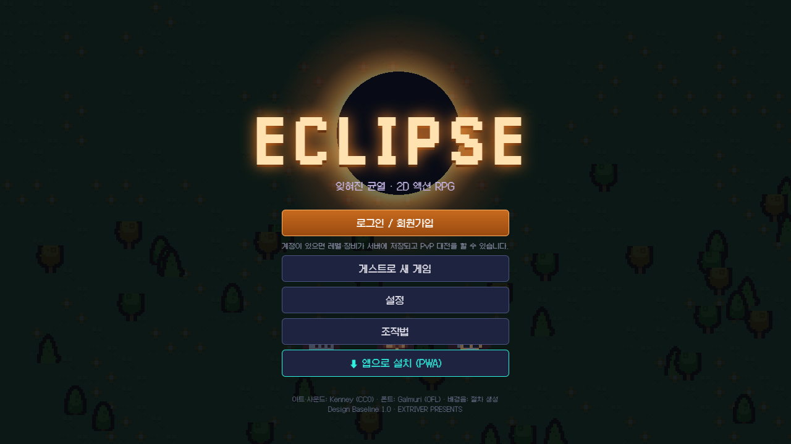

<div align="center">



# ECLIPSE — 잊혀진 균열

**설치 없이 브라우저에서 바로 켜지는 50레벨 픽셀 액션 RPG**

5직업 · 보스 10종 · 메인 퀘스트 50개 · 실시간 1:1 PvP · 오프라인 플레이(PWA)


</div>

---

## 목차

- [소개](#소개)
- [주요 기능](#주요-기능)
- [빠른 시작](#빠른-시작)
- [조작법](#조작법)
- [게임 구성](#게임-구성)
- [계정 · 저장 · PvP](#계정--저장--pvp)
- [기술 스택](#기술-스택)
- [프로젝트 구조](#프로젝트-구조)
- [알려진 한계](#알려진-한계)
- [크레딧 · 라이선스](#크레딧--라이선스)

## 소개

하늘에 뜬 검은 해, 그리고 세계를 갉아먹는 균열.
**ECLIPSE**는 50레벨 액션 RPG 기획서 한 권을 처음부터 끝까지 코드로 옮긴 2D 브라우저 게임입니다.

- 패링, 대시 무적, 입력 버퍼, 콤보 랭크까지 손맛에 집중한 **실시간 액션 전투**
- 숲에서 균열의 심장까지 **5챕터 · 레벨 1~50**의 성장 곡선
- 페이즈가 바뀌는 **보스 10종**과 던전 10개
- 회원가입하면 **다른 기기에서 이어서** 플레이하고, 투기장에서 **실시간 1:1 PvP**
- 한 번 열면 **앱처럼 설치**되고, 이후에는 **인터넷 없이도** 실행

## 주요 기능

| 영역 | 내용 |
|---|---|
| ⚔️ 전투 | 약 · 강공격 콤보(L-L-L, L-L-H, L-H-H, D-L-H, F-L-H), 대시 무적 70~190ms, 패링 120ms + 반격, 입력 버퍼 130ms, 콤보 랭크 D~S |
| 🧙 직업 | 검사 · 격투가 · 마법사 · 궁수 · 창술사, 직업별 스킬 계수와 4단계 특성 |
| 🗺️ 월드 | 강 · 늪 · 빙하 호수 · 용암 강 · 공허 낭떠러지 같은 지형, 챕터마다 다른 마을과 필드, 방 + 복도형 던전 |
| 👹 적 | 일반 몬스터 30종(AI 16가지), 엘리트, 상태 머신과 페이즈를 가진 보스 10종 |
| 📜 퀘스트 | 메인 퀘스트 50개, 사이드 퀘스트 20종, 갈라지는 엔딩 |
| 🎒 장비 | 8슬롯 · 6등급 · 랜덤 옵션 · 강화(+8) · 재련 · 제작 · 분해, 유물 10종, 전설 천장 |
| 🌐 온라인 | 회원가입 · 로그인, 캐릭터 3슬롯, 클라우드 세이브, ELO 랭킹 PvP |
| 📱 PWA | 앱 설치, 오프라인 실행, 새 버전 자동 업데이트, 게임패드 지원 |
| ♿ 접근성 | 광과민 모드, 화면 흔들림 끄기, 보스 패턴명 표시 |

## 빠른 시작

**필요한 것**: Node.js 22.5 이상 (내장 SQLite를 사용해서 DB 설치가 따로 필요 없습니다)

```bash
git clone https://github.com/HyeonbinJung/eclipse-game.git
cd eclipse-game
npm install
npm run serve        # 빌드 + 게임 서버 → http://localhost:4173
```

Windows에서는 `ECLIPSE 실행.bat`을 더블클릭하면 빌드부터 브라우저 열기까지 한 번에 됩니다.

### 개발 모드

```bash
npm start            # 터미널 1: 게임 서버 (API · WebSocket)
npm run dev          # 터미널 2: Vite 개발 서버 → http://localhost:5173
```

개발 서버는 API와 소켓 요청을 게임 서버로 넘겨 줍니다.

### 친구에게 공개하기

```bash
npm run serve
ngrok http 4173      # ngrok이 주는 https 주소를 공유
```

https 주소라서 접속한 사람도 회원가입 · PvP · 앱 설치를 모두 할 수 있습니다.

### 스크립트

| 명령 | 설명 |
|---|---|
| `npm run dev` | Vite 개발 서버 |
| `npm run build` | 프로덕션 빌드 (`dist/`) |
| `npm start` | 게임 서버만 실행 |
| `npm run serve` | 빌드 후 게임 서버 실행 |
| `npm run preview` | 빌드 결과를 Vite로 미리 보기 |

## 조작법

| 키 | 동작 |
|---|---|
| `W` `A` `S` `D` | 이동 |
| 마우스 | 조준 |
| 좌클릭 / 우클릭 | 약공격 / 강공격 (좌클릭을 누르고 있으면 연타) |
| `Space` / `Shift` | 대시 (무적 시간 있음) |
| `F` | 패링, 성공 후 0.45초 안에 약공격으로 반격 |
| `Q` / `E` / `R` | 스킬 (Lv4 / Lv8) / 궁극기 (Lv20) |
| `1` | HP 포션 |
| `G` | 상호작용 |
| `I` / `J` / `K` | 가방 / 퀘스트 / 특성 |
| `ESC` / `F1` | 메뉴(투기장 · 랭킹) / 도움말 |

Xbox 배치 게임패드도 지원합니다.

## 게임 구성

| 챕터 | 지역 | 레벨 | 대표 보스 |
|---|---|---|---|
| 1 | 망령의 숲 | 1~10 | 숲의 포식자, 뿌리의 수호자 |
| 2 | 몰락한 왕성 | 11~20 | 검은 근위대장, 타락한 기사왕 |
| 3 | 얼어붙은 심연 | 21~30 | 서리의 사냥꾼, 서리의 여왕 |
| 4 | 타오르는 황무지 | 31~40 | 용암 포식자, 불멸의 화신 |
| 5 | 균열의 심장 | 41~50 | 공허의 집행관, 균열의 군주 |

마지막에는 균열을 **봉인할지, 재건할지** 직접 고릅니다.

## 계정 · 저장 · PvP

- **회원가입 / 로그인**: 비밀번호는 scrypt 해시로 저장하고, 세션은 30일 유지됩니다. 계정당 캐릭터 3개까지 만들 수 있습니다.
- **클라우드 세이브**: 진행이 바뀔 때마다 서버에 올리고(2초 간격으로 묶어서), 창을 닫을 때도 저장합니다. 다른 기기에서 로그인해도 그대로 이어집니다.
- **게스트 플레이**: 로그인 없이도 플레이할 수 있습니다. 이 경우 브라우저에만 저장되고 PvP는 할 수 없습니다.
- **PvP 투기장**: 마을의 투기장 관리인이나 `ESC` 메뉴에서 빠른 대전 또는 방 코드로 입장합니다. 1:1 실시간 2분, HP 2배 · 피해 0.7배 · 포션 금지 규칙이고, ELO 레이팅으로 랭킹이 매겨집니다.

## 기술 스택

| 구분 | 사용 기술 |
|---|---|
| 클라이언트 | TypeScript, Phaser 3, Vite |
| 서버 | Node.js (`http` + `ws`), 내장 `node:sqlite` |
| 실시간 | WebSocket (PvP 매칭 · 동기화) |
| 앱 | Web App Manifest + Service Worker (오프라인 캐시) |
| 사운드 | Kenney 효과음 + WebAudio로 만든 절차 생성 배경음 |
| 테스트 | Playwright 기반 스모크 · E2E 스크립트 (`tools/`) |

## 프로젝트 구조

```
eclipse-game/
├─ index.html
├─ public/                 # 아이콘, manifest, 스프라이트 · 이펙트 · 사운드
├─ server/
│  └─ index.mjs            # 정적 파일 + 계정/세이브 API + PvP WebSocket
├─ src/
│  ├─ main.ts              # 게임 부트스트랩
│  ├─ pwa.ts               # 서비스 워커 등록 · 설치 버튼
│  ├─ scenes/              # Boot · Title · World · Hud
│  ├─ game/                # 플레이어 · 적 · 보스 · 전투 · 지형 · 맵 생성
│  ├─ data/                # 직업 · 몬스터 · 보스 · 아이템 · 월드 · 공식
│  ├─ core/                # 게임 상태 · 능력치 계산
│  ├─ net/                 # API 클라이언트 · PvP 소켓
│  ├─ ui/                  # 메뉴 · 계정 화면 · 스타일
│  └─ audio/               # 효과음 · 배경음
└─ tools/                  # 스모크 테스트, 아이콘 생성 등 개발용 스크립트
```

## 알려진 한계

- PvP 판정은 맞는 쪽 화면을 기준으로 합니다. 서버가 능력치 상한과 메시지 속도는 검사하지만, 완전한 서버 권위 판정이 아니어서 본격적인 치트 방지는 추가 작업이 필요합니다.
- 게임 데이터(`server/data/`)는 저장소에 포함되지 않으며, 서버를 처음 실행할 때 자동으로 만들어집니다.

## 크레딧 · 라이선스

| 리소스 | 출처 | 라이선스 |
|---|---|---|
| 캐릭터 · 몬스터 · 타일 · 아이템 | Kenney *Tiny Dungeon*, *Tiny Town* | CC0 |
| 이펙트 | Kenney *Particle Pack* | CC0 |
| 효과음 · 징글 | Kenney *Impact Sounds*, *RPG Audio*, *Interface Sounds*, *Music Jingles* | CC0 |
| 폰트 | Galmuri (quiple) | SIL OFL 1.1 |
| 배경음 | WebAudio 절차 생성 (자체 코드) | — |

원본 라이선스 전문은 [`public/assets/LICENSE-kenney.txt`](public/assets/LICENSE-kenney.txt), [`public/assets/LICENSE-galmuri-OFL.txt`](public/assets/LICENSE-galmuri-OFL.txt)에 있습니다.
